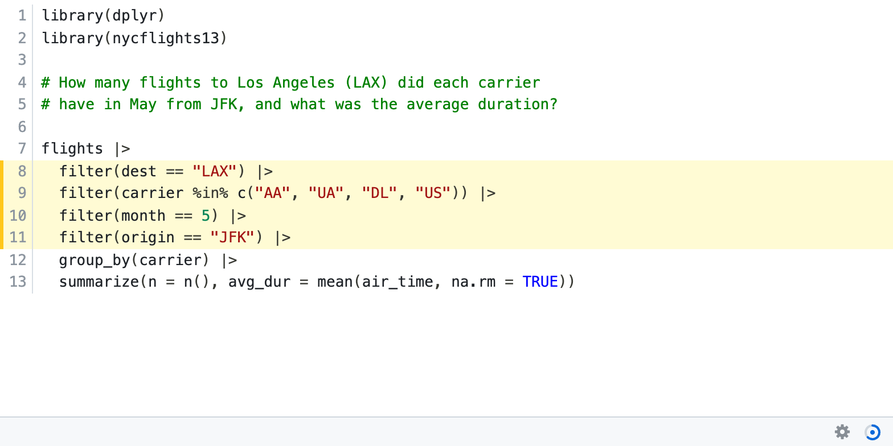
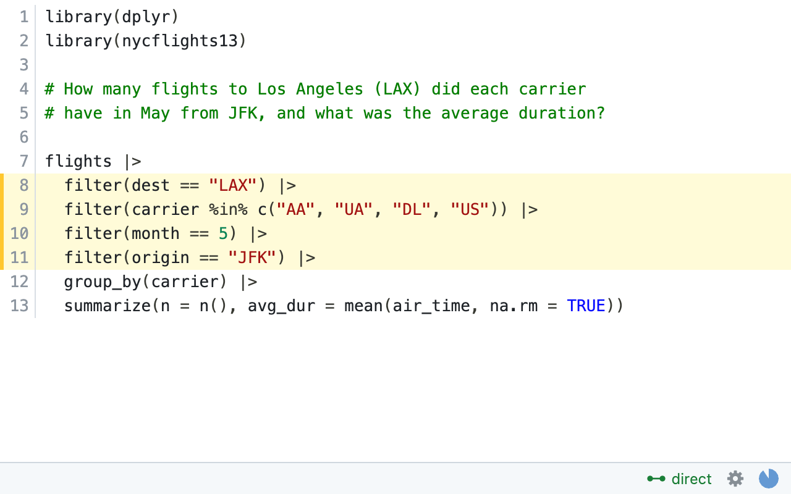

# livecode 

<!-- badges: start -->
[](https://github.com/rundel/livecode/actions/workflows/R-CMD-check.yaml)

<!-- badges: end -->

<br/>

livecode is an R package that lets you broadcast a local R (or any other text) document over the web and provide live updates as it is edited.

<br/>



## Installation

You can install the development version of `livecode` from GitHub with:

``` r
# install.packages("pak")
pak::pak("rundel/livecode")
```

The package includes compiled code, so installing from source needs a working compiler toolchain (Rtools on Windows, the Xcode command line tools on macOS).

## Usage

``` r
# From RStudio with an open R script (in Positron this call blocks, see Editors below)
server = livecode::serve_file()
#> ✔ Started sharing 'example.R' at <http://192.168.1.128:30000>.
#> ! The current ip address ("192.168.1.128") for the server is private, only users on the same local network are likely to be able to connect.

# Or share a specific file from any R session
server = livecode::serve_file("example.R")

# Once started, send messages to your users.
server$send_msg("Hello World!", type = "success")
server$send_msg("Oh no!\n\n Something bad has happened.", type = "error")

# Once finished, shut the server down.
server$stop()
#> ✔ Stopped server at <http://192.168.1.128:30000>.
```

The server listens on the address of your preferred network interface, which you can inspect (and override with the `ip` argument) using `livecode::network_interfaces()`. Only IPv4 addresses are supported. Students open that address in a browser.

## The page

The page highlights the file according to its extension (R, Quarto and R Markdown, Python, SQL, and other common languages, with anything else shown as plain text), numbers the lines as they are in the file, and highlights and scrolls to the lines selected in the editor. Messages sent with `server$send_msg()` appear as notifications in a corner of the page.

A status bar along the bottom holds everything that is not code:

| In the status bar                    | Meaning                                                                                   |
|--------------------------------------|-------------------------------------------------------------------------------------------|
| Nothing on the left                  | Connected and up to date                                                                  |
| "Disconnected, reconnecting…"        | The connection dropped; the page retries on its own and catches up                        |
| "The session has ended."             | You stopped the server or the broadcast                                                   |
| "direct" or "relay" (followers only) | Whether a follower's tailcat connection goes straight to your computer or through a relay |
| Gear button                          | Display settings for this viewer                                                          |
| Circle                               | Time until the next update                                                                |

After the session has ended the page keeps the last text it showed. The page of a server still retries quietly, so it picks up again if you restart the server at the same address.

From the gear button each viewer can change the code font size and turn off following your cursor or the line highlighting. These settings only affect that viewer's page and reset to the defaults when the page is reloaded.

## Editors

livecode works with RStudio and Positron. In either IDE, `serve_file()` with no arguments shares the active document, the page shows the editor's text of that document, including edits you have not saved, and the lines you select are highlighted while it is the active document. Nothing needs to be saved for students to see your edits. From any other R session pass the path of the file; the page then shows the file on disk and updates whenever it is saved.

Positron answers requests from R only while a console command is running. So in Positron `serve_file()` keeps running and drives the broadcast itself (`block = TRUE`, the default there): the console you call it from is dedicated to the broadcast until you interrupt it with Esc or Ctrl-C, which stops the server. Do your work in a second R console session meanwhile.

``` r
# Positron, console 1: runs until interrupted
livecode::serve_file("lecture.R")
#> ✔ Started sharing 'lecture.R' at <http://192.168.1.128:30000>.
#> ℹ This console now runs the broadcast until you interrupt it (Esc or Ctrl-C). Do your work in a second R console session.

# After Esc or Ctrl-C
#> ✔ Stopped sharing 'lecture.R' at <http://192.168.1.128:30000>.
```

The two IDEs differ in a few ways:

| Behavior               | RStudio                                                                                    | Positron                                                                                                   |
|------------------------|--------------------------------------------------------------------------------------------|------------------------------------------------------------------------------------------------------------|
| `serve_file()` returns | Straight away (`block = FALSE` by default)                                                 | When interrupted or stopped (`block = TRUE` by default)                                                    |
| Text shown             | The served document's buffer, read by id, also while another tab is active                 | The served document's buffer while it is the active editor; the last text seen while another tab is active |
| Highlight              | Follows the cursor while the served document is active, cleared otherwise                  | Follows the cursor while the served document is active, cleared otherwise                                  |
| Saving                 | Not needed; `auto_save = TRUE` also saves the document at every update                     | Not needed; `auto_save = TRUE` is an error, use Positron's `files.autoSave` setting if you want saving     |
| Formatting on save     | With `auto_save = TRUE`, warns if "Strip trailing horizontal whitespace when saving" is on | livecode never saves                                                                                       |
| Rename or Save As      | Followed: the renamed document keeps being served                                          | Not followed: the original path stays served                                                               |

A few more details:

- Your own copy of the page opens in the IDE's Viewer pane, and in the system browser outside an IDE. Set `options(livecode.viewer = FALSE)` to always use the browser; `open_browser = FALSE` opens nothing.
- The Viewer cannot always reach the server's network address: RStudio's shows pages of this computer only, and in a Posit Workbench session your browser reaches the session through Workbench. So in an IDE the server also serves your copy of the page on 127.0.0.1, under a random token in its address without which nothing is served there. Students keep using the network address or the tailcat broadcast.
- If RStudio cannot read a document by its id, livecode says so once and reads the served document only while it is active.
- With `block = FALSE` in Positron, livecode cannot read the editor after startup: the page shows the file on disk with no highlight, so turn on Positron's auto save (`files.autoSave`) if you go that way. `block = TRUE` also works in RStudio and outside an IDE, for example from `Rscript`.
- While `serve_file()` blocks, its console is busy, so `server$send_msg()` and the other server methods cannot be called from it. If you need them, use `block = FALSE` (in Positron at the cost of the live buffer and highlight).
- The IDE is detected automatically; set `options(livecode.editor = "none")` (or `"rstudio"`, `"positron"`) to override it.

## Broadcasting over tailcat

The page is served on your local network only. To reach students anywhere, also broadcast the file over [tailcat](https://github.com/tailscale/tailcat), an end-to-end encrypted transport that connects directly when it can and through tailcat's public relays otherwise. This needs the [rtailcat](https://github.com/rundel/rtailcat) package on both ends.

``` r
# Instructor
server = livecode::serve_file("lecture.R", tailcat = TRUE)
#> ✔ Started sharing 'lecture.R' at <http://192.168.1.128:30000>.
#> ✔ Tailcat broadcast ready. Students run:
#> livecode::follow("tc...")

# Student, from any R session with internet access
livecode::follow("tc...")
#> ℹ Connecting to the broadcast…
#> ✔ Following 'lecture.R' at <http://127.0.0.1:28664/0dda6f56c91a20cf430cf5a918ccc058/>.
#>   Run livecode::unfollow() to stop following.
```



### For students

`follow()` opens a page served by the student's own R session, in the Viewer pane of RStudio or Positron and elsewhere in the system browser. It shows what your page shows: the highlighted file, the selected lines, and your messages, which followers see as plain text. Its status bar also says whether the connection to you is direct or goes through a relay.

- The page is served on 127.0.0.1 only, under a random token in its address without which nothing is served, so only the page that `follow()` opened can read the session. This also holds when an IDE shows the page through a proxy, as Posit Workbench does.
- `follow()` only ever displays what it receives; it never runs or saves it.
- If the broadcast drops, the page says that it is reconnecting and catches up on its own.
- When you stop the broadcast, followers are told that the session has ended and stop reconnecting. To follow a broadcast that you start again, they run `follow()` again.
- A follower runs until the student stops it; closing the Viewer or the browser tab does not. `livecode::unfollow()` stops every follower of the R session, and `livecode::unfollow(port)` only the one whose page is on that port, the number after `127.0.0.1:` in its address.
- Running `follow()` again with an address that is already being followed reuses the running follower and its page.

### For the instructor

On a running server, `server$start_tailcat()` and `server$stop_tailcat()` start and stop the broadcast and `server$tailcat_address` gives the address; `server$stop()` stops the broadcast as well. The broadcast runs in a separate R process, so a problem in it cannot take down your session, and it keeps going while your session is busy. It only ever sends: nothing a follower sends is read, followers that fall behind are dropped (they reconnect and catch up), and at most 150 are connected at once (`max_clients`).

If the local network address is of no use, or you would rather not show it, add `local_only = TRUE`. The page is then served on 127.0.0.1 only, for your own use, and the tailcat broadcast is the only way in for everyone else. It is only allowed together with `tailcat`.

``` r
server = livecode::serve_file("lecture.R", tailcat = TRUE, local_only = TRUE)
#> ✔ Started sharing 'lecture.R' at <http://127.0.0.1:30000>.
#> ℹ The page is served on this computer only, everyone else follows the tailcat broadcast.
#> ✔ Tailcat broadcast ready. Students run:
#> livecode::follow("tc...")
```

By default every broadcast gets a fresh address that stops working when the broadcast stops. To post an address before class, create keys ahead of time and pass them at class time:

``` r
keys = livecode::tailcat_keys("stat101-2026-11-12.rds") # creates the file, readable by you only
keys$address                                             # post this
server = livecode::serve_file("lecture.R", tailcat = keys)
```

Before relying on it in class:

- The address is a credential: anyone who has it can follow the session. Post it where only you can edit, such as the course site or an LMS announcement, not a shared document or chat thread, where someone could swap in the address of their own broadcast.
- Use fresh keys for each class meeting. Everyone who ever had an address can use it for as long as its keys are used.
- Students need rtailcat, which is not on CRAN yet. Installing it with `pak::pak("rundel/rtailcat")` builds it from source and needs a [Go toolchain](https://go.dev/doc/install), so have students install it before the first class.
- Do a dry run in the room. If the network keeps devices apart, all traffic goes through the public relays, which are rate limited and have no uptime guarantee.

## Managing servers and followers

Every server and follower started in the current session is tracked, so you can find or stop them even if you did not keep the returned object.

``` r
# List the servers that are currently running
livecode::list_servers()

# Stop the followers, or the one whose page is on a port
livecode::unfollow()
livecode::unfollow(28664)

# Stop every server and follower
livecode::stop_all()
```

Running servers and followers are also stopped when the package is unloaded.
