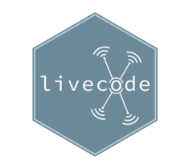
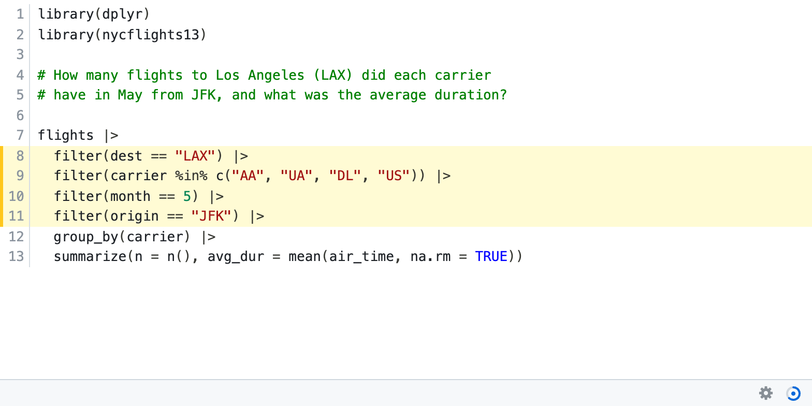

---
format:
  gfm:
    wrap: preserve
    columns: 1000
from: markdown-smart
---
# livecode 

<!-- badges: start -->
[](https://github.com/rundel/livecode/actions/workflows/R-CMD-check.yaml)

<!-- badges: end -->

<br/>

livecode is an R package that lets you broadcast a local R (or any other text) document over the web and provide live updates as it is edited.

<br/>




## Installation

You can install the development version of `livecode` from GitHub with:

``` r
# install.packages("pak")
pak::pak("rundel/livecode")
```

The package includes compiled code, so installing from source needs a working compiler toolchain (Rtools on Windows, the Xcode command line tools on macOS).

## Usage

``` r
# From RStudio or Positron with an open R script
server = livecode::serve_file()
#> ✔ Started sharing 'example.R' at <http://192.168.1.128:30000>.
#> ! The current ip address ("192.168.1.128") for the server is private, only users on the same local network are likely to be able to connect.

# Or share a specific file from any R session
server = livecode::serve_file("example.R")

# Once started, send messages to your users.
server$send_msg("Hello World!", type = "success")
server$send_msg("Oh no!\n\n Something bad has happened.", type = "error")

# Once finished, shut the server down.
server$stop()
#> ✔ Stopped server at <http://192.168.1.128:30000>.
```

The server listens on the address of your preferred network interface, which you can inspect (and override with the `ip` argument) using `livecode::network_interfaces()`. Only IPv4 addresses are supported.

The page highlights the file according to its extension (R, Quarto and R Markdown, Python, SQL, and other common languages, with anything else shown as plain text), numbers the lines as they are in the file, and highlights and scrolls to the lines selected in the editor. If the connection drops, for example while the server restarts, the page shows that it is reconnecting and catches up on its own.

## Editors

livecode works with RStudio and Positron. In either IDE, `serve_file()` with no arguments shares the active document, the lines you select are highlighted on the page, and with `auto_save = TRUE` (the default) the file is saved at every update so students see your edits as you type. From any other R session pass the path of the file; the page then updates whenever the file is saved.

The two IDEs differ in a few ways:

| Behavior           | RStudio                                                                    | Positron                                                                                                         |
|--------------------|----------------------------------------------------------------------------|------------------------------------------------------------------------------------------------------------------|
| Auto-save          | Saves the served document wherever it is open                              | Saves only while the served file is the active editor tab                                                        |
| Formatting on save | Warns if "Strip trailing horizontal whitespace when saving" is on          | Saves without formatting when possible, otherwise names `editor.formatOnSave` and `files.trimTrailingWhitespace` |
| Rename or Save As  | Reported once; the original file keeps being served and is no longer saved | Not detected; the original file keeps being served                                                               |

The IDE is detected automatically; set `options(livecode.editor = "none")` (or `"rstudio"`, `"positron"`) to override it.

## Broadcasting over tailcat

The page is served on your local network only. To reach students anywhere, also broadcast the file over [tailcat](https://github.com/tailscale/tailcat), an end-to-end encrypted transport that connects directly when it can and through tailcat's public relays otherwise. This needs the [rtailcat](https://github.com/rundel/rtailcat) package on both ends.

``` r
# Instructor
server = livecode::serve_file("lecture.R", tailcat = TRUE)
#> ✔ Started sharing 'lecture.R' at <http://192.168.1.128:30000>.
#> ✔ Tailcat broadcast ready. Students run:
#> livecode::follow("tc...")

# Student, from any R session with internet access
livecode::follow("tc...")
```

`follow()` opens a page served by the student's own R session, on 127.0.0.1 only, with the same view as the instructor's page: the highlighted file, the selected lines, and messages, which followers see as plain text. The page reconnects by itself if the broadcast drops or restarts. `stop_all()` stops followers too.

On a running server, `server$start_tailcat()` and `server$stop_tailcat()` start and stop the broadcast and `server$tailcat_address` gives the address; `server$stop()` stops the broadcast as well. The broadcast runs in a separate R process, so a problem in it cannot take down your session, and it keeps going while your session is busy. It only ever sends: nothing a follower sends is read, followers that fall behind are dropped (they reconnect and catch up), and at most 150 are connected at once (`max_clients`).

By default every broadcast gets a fresh address that stops working when the broadcast stops. To post an address before class, create keys ahead of time and pass them at class time:

``` r
keys = livecode::tailcat_keys("stat101-2026-11-12.rds") # creates the file, readable by you only
keys$address                                             # post this
server = livecode::serve_file("lecture.R", tailcat = keys)
```

Before relying on it in class:

- The address is a credential: anyone who has it can follow the session. Post it where only you can edit, such as the course site or an LMS announcement, not a shared document or chat thread, where someone could swap in the address of their own broadcast. `follow()` only ever displays what it receives; it never runs or saves it.
- Use fresh keys for each class meeting. Everyone who ever had an address can use it for as long as its keys are used.
- Students need rtailcat, which is not on CRAN yet. Installing it with `pak::pak("rundel/rtailcat")` builds it from source and needs a [Go toolchain](https://go.dev/doc/install), so have students install it before the first class.
- Do a dry run in the room. If the network keeps devices apart, all traffic goes through the public relays, which are rate limited and have no uptime guarantee.

## Managing servers

Every server started in the current session is tracked, so you can find or stop them even if you did not keep the returned object.

``` r
# List the servers that are currently running
livecode::list_servers()

# Stop all of them
livecode::stop_all()
```

Running servers and followers are also stopped when the package is unloaded.
